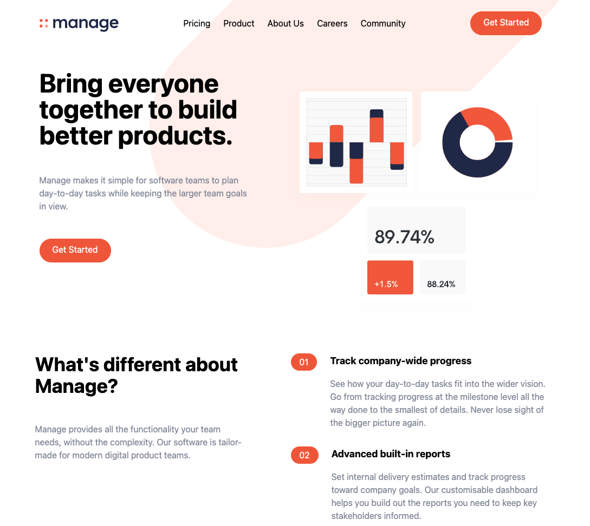

# 🎨 Manage Landing Page

A responsive landing page for "Manage", a sample project-management product, built while
following a Tailwind CSS crash course on YouTube (2022). It's a practice project: one static HTML
page, Tailwind for the styling, and a few lines of JavaScript for the mobile menu.



## What's in it

- **Sections:** navbar, hero, a numbered "What's different" feature list, testimonials, a
  call-to-action banner, and a footer with social icons, links and a newsletter field.
- **Mobile menu:** a CSS-drawn hamburger that turns into a close icon, toggled by
  `js/script.js`.
- **Custom theme** in `tailwind.config.js`: brand colours (`brightRed`, `darkBlue`, …) and
  breakpoints at 480, 768, 976 and 1440 px.
- **Plain CSS** in `input.css` for the background patterns and the hamburger animation.

The nav links, buttons and newsletter form are placeholders; nothing is wired up.

## Open it

It isn't deployed anywhere. The compiled stylesheet (`css/main.css`) is committed, so you can
open `index.html` in your browser without installing anything:

```bash
open index.html   # macOS; or just double-click the file
```

## Edit the styles

```bash
npm install
npm run watch   # recompile css/main.css from input.css on every change
npm run build   # compile once
```

Tailwind (v3) scans `./*.html` for classes. To change the input or output file, edit the scripts
in `package.json`; to change which files are scanned, edit `content` in `tailwind.config.js`.
